# SKY COURIER — 하늘길 배달부

> FPV 드론으로 도시·산·농장·화성을 누비며 배송하고, 적 드론과 괴물을 사냥하는 **Godot 4 3D 게임**.
> 에셋 대부분(지형·건물·차량·사람·드론·괴물·음악·효과음)을 **코드로 생성**했고, 외부 에셋은 CC0 캐릭터와 오픈 폰트뿐입니다.

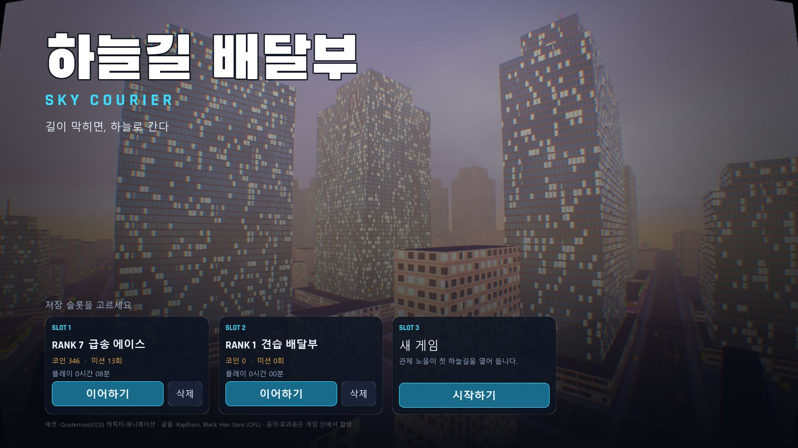

| | |
|---|---|
| 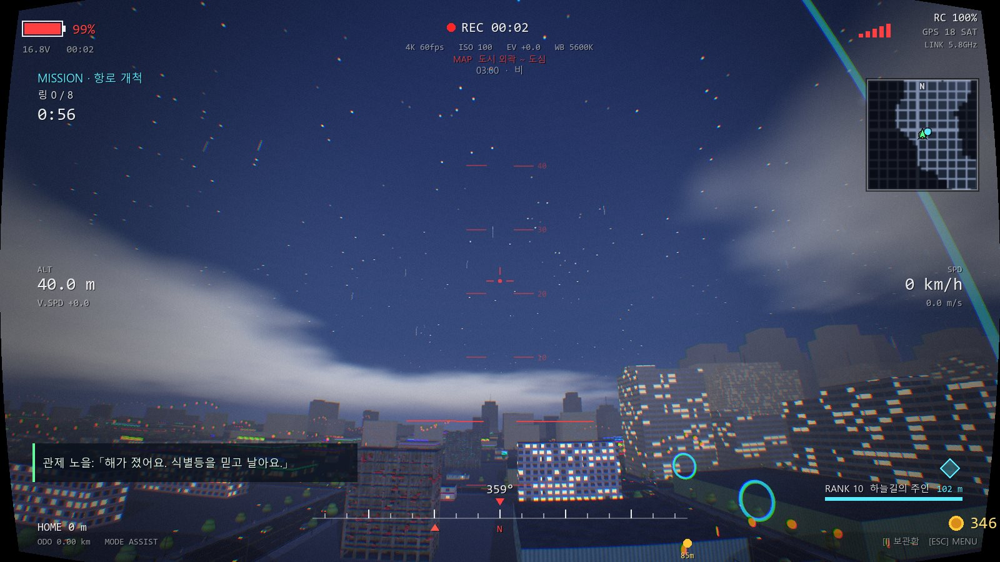 | 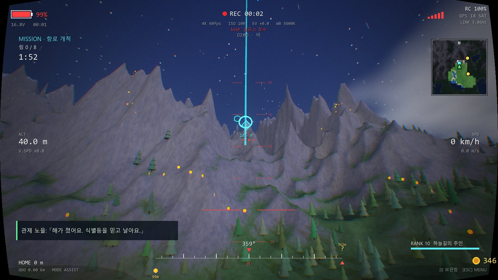 |
| 도시 · 밤비 · 링 통과 미션 (밤/날씨 사이클, 창문·가로등 발광) | 알프스 · 야간 비행 (미션 목표 링과 거리 표시) |

---

## 1. 한눈에 보기

| 항목 | 내용 |
|---|---|
| 엔진 / 언어 | Godot 4.7.2 (Forward+), GDScript, GLSL(Godot shader) |
| 규모 | GDScript 약 11,800줄 (41개 파일) · 셰이더 약 1,100줄 (17개) |
| 맵 | 도시 · 알프스 호수 · 시골 농장 · 화성 (무한 생성 지형) |
| 모드 | 자유 비행(배송 의뢰) · 드론 대전(웨이브) · 괴물 사냥 |
| 진행 | 랭크 10단계, 맵·기체 해금, 목표 22개, 미션 별점·기록, 숨겨진 상자 40개 |
| 저장 | 슬롯 3개(JSON), 키 재설정, 그래픽 3단계, 색약 모드 |
| 플랫폼 | Windows (릴리스에 exe + pck) |

### 주요 기능
- **FPV 비행 모델**: 추력·항력·기울기·배터리·신호 거리·바람·충돌(지형/건물/차량), 비행 보조(F), 1인칭/3인칭(V), 마우스 에임 방향 추종 상승·하강
- **살아 있는 도시**: 차선·신호등·좌/우회전·경찰차 사이렌, 횡단보도를 건너는 보행자, 대화하는 무리 (모두 실시간 시뮬레이션)
- **낮밤·날씨**: 하루 약 14분 사이클, 비·번개·안개·화성 먼지 폭풍, 별/달, 야간 식별등
- **미션 4종**: 링 통과 / 급송 배달 / 사진 / 정밀 착륙 + ★1~3 평가와 최고 기록
- **전투**: 기관포(무제한 탄약) + 록온 유도탄, 적 AI, 체력 바, 피격 방향 표시, 유혈 파티클
- **성장 요소**: 기체 4종 · 외장 10종 · 업그레이드 8종(외형에도 반영) · 전리품 13종 보관함/판매
- **합성 사운드**: 배경음악 7곡과 효과음을 런타임에 수학적으로 합성 (음원 파일 0개)

---

## 2. 스크린샷

### 로비 — 모드 선택 / 격납고 / 보관함
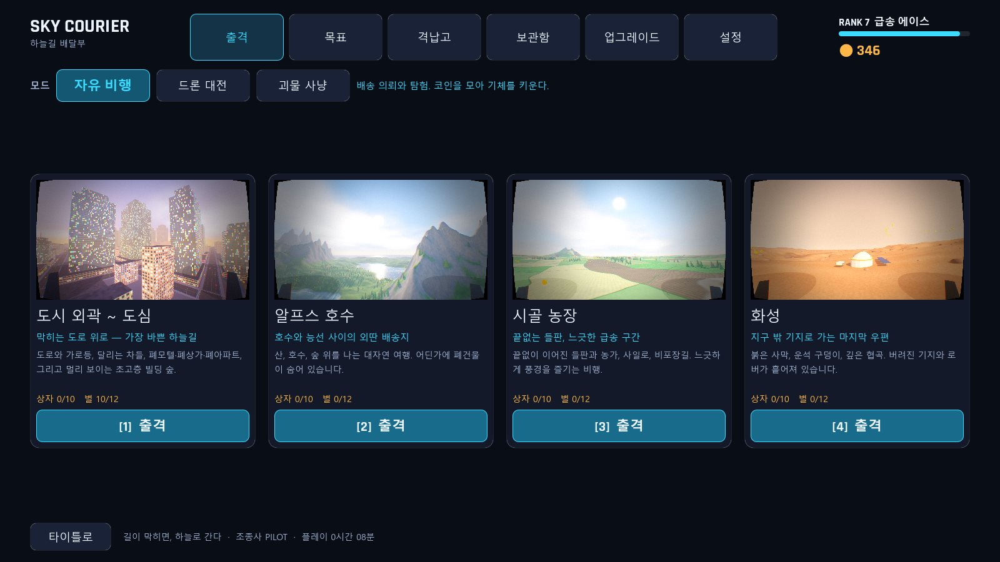
출격 화면 위쪽에서 모드(자유 비행 / 드론 대전 / 괴물 사냥)를 고르고 맵을 선택합니다. 맵 카드 이미지는 실제 플레이 화면을 캡처한 것입니다.

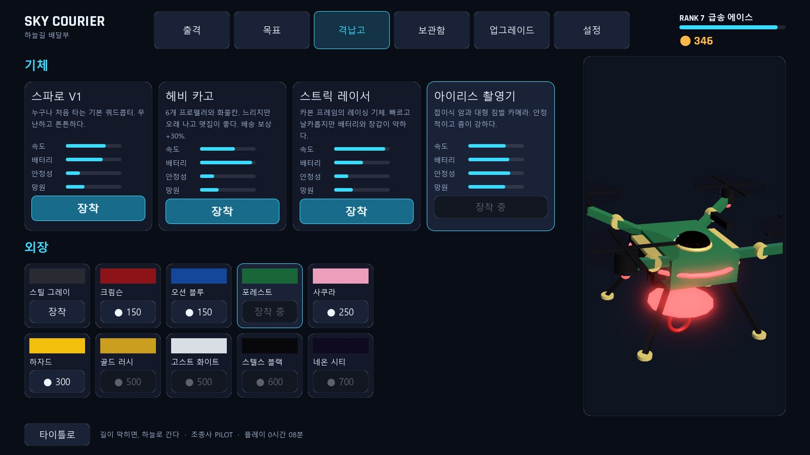
기체 4종·외장 10종을 고르면 오른쪽 3D 미리보기가 돌아갑니다. 업그레이드 단계(모터 링, 안테나, 망원 렌즈, 자석, 바닥 발광 등)가 모델에 그대로 붙습니다.

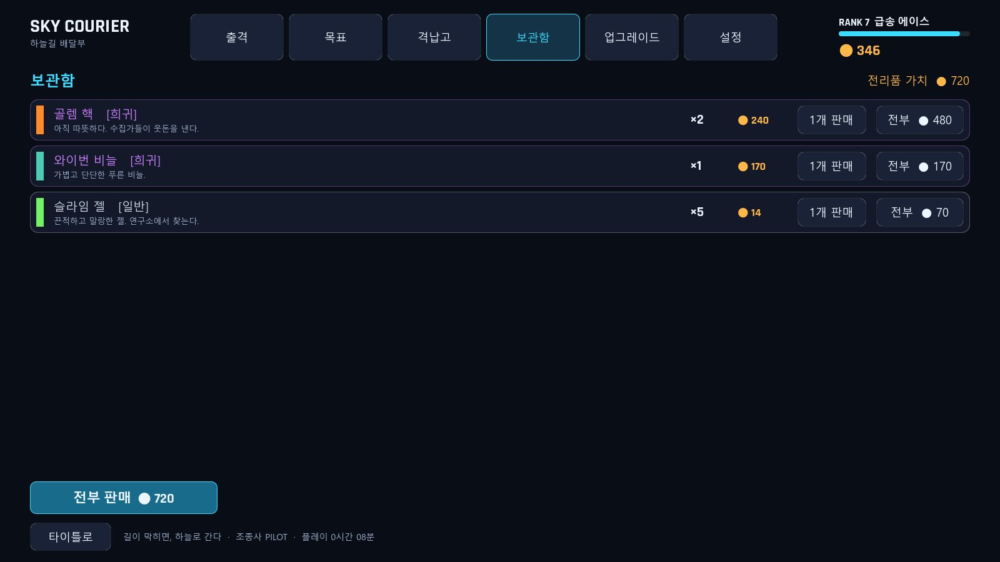
전투 전리품은 보관함(로비 탭 / 게임 중 `I`)에서 코인으로 판매합니다.

### 비행
| | |
|---|---|
| 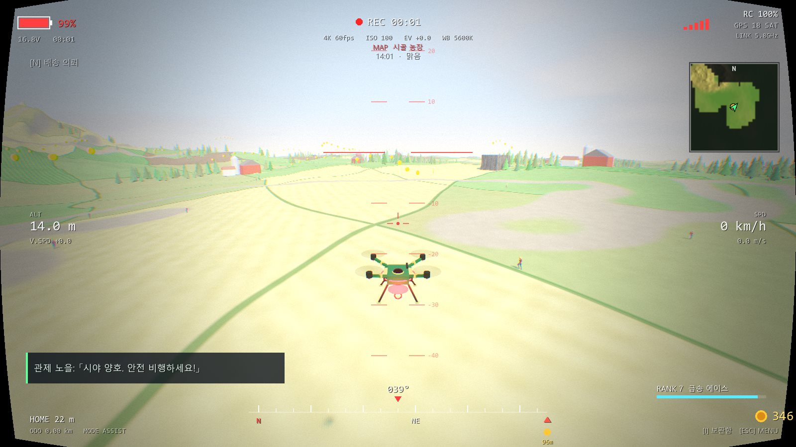 | 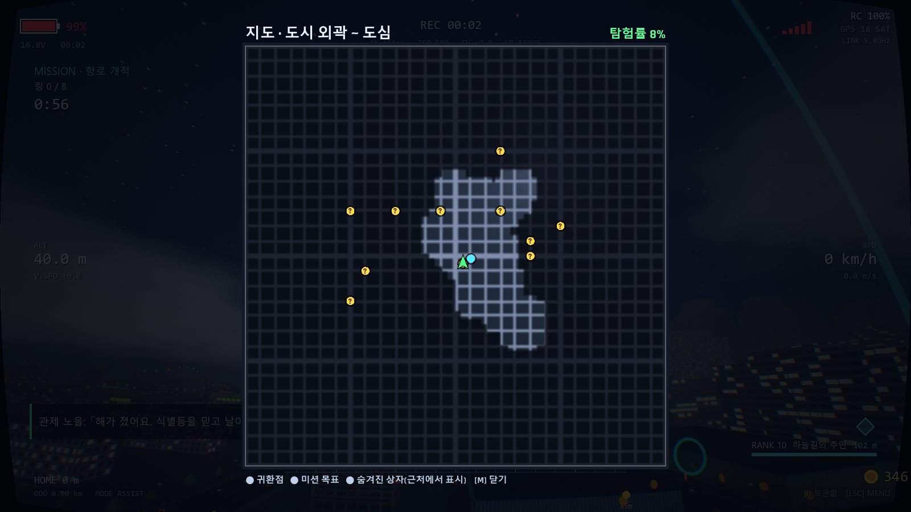 |
| 3인칭 시점(V) — 장착한 기체·외장이 그대로 보임 | 전체 지도(M) — 가 본 곳만 밝아지는 전장의 안개, 숨겨진 상자 표시 |

### 전투
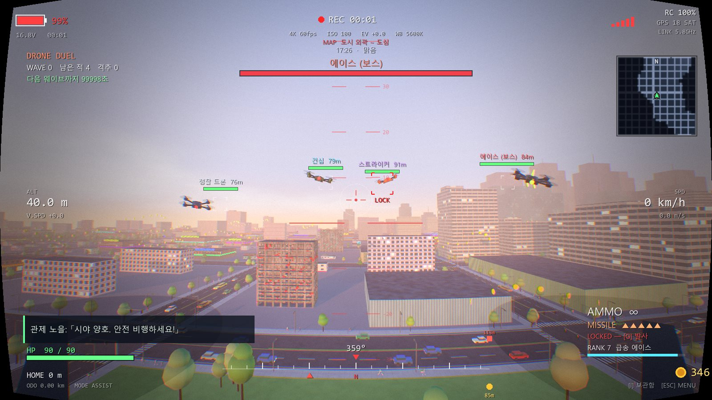
드론 대전: 적 드론 4종(정찰·건십·스트라이커·에이스)이 웨이브로 옵니다. 적을 화면 가운데에 두면 `LOCK`이 잡히고 `G`로 유도탄을 발사합니다.

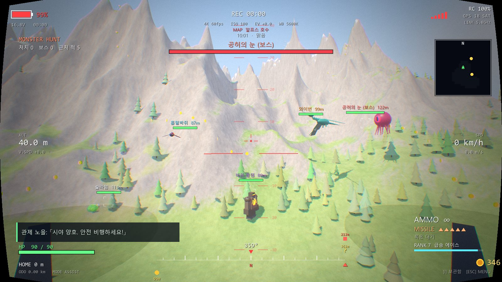
괴물 사냥: 슬라임 → 흡혈박쥐 → 바위 골렘 → 와이번 → 공허의 눈(보스). 이름 색은 난이도(tier)를 뜻합니다.

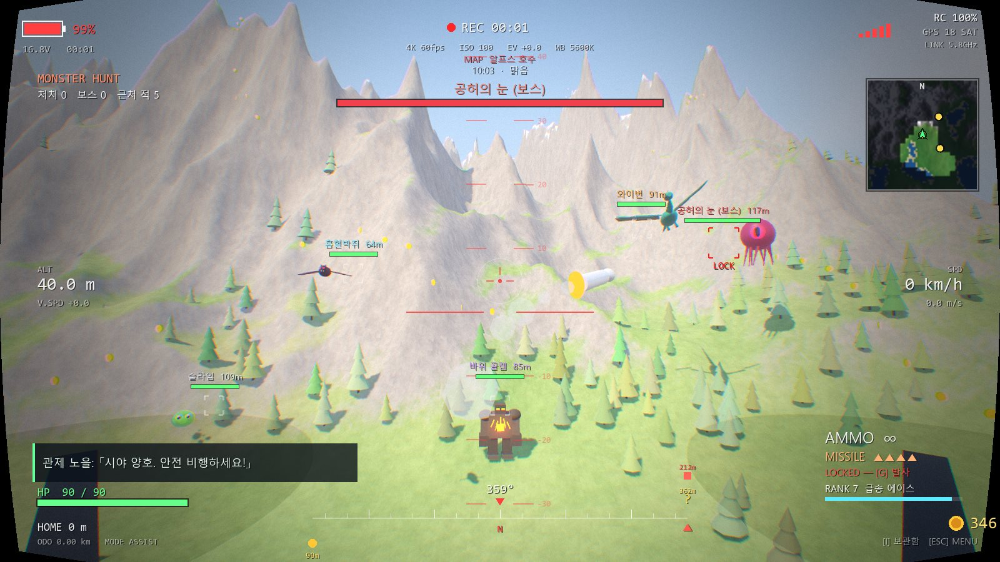
유도탄 발사 직후(연기 궤적). 록온 중에는 사각 브래킷이 줄어들고, 완료되면 붉게 고정됩니다.

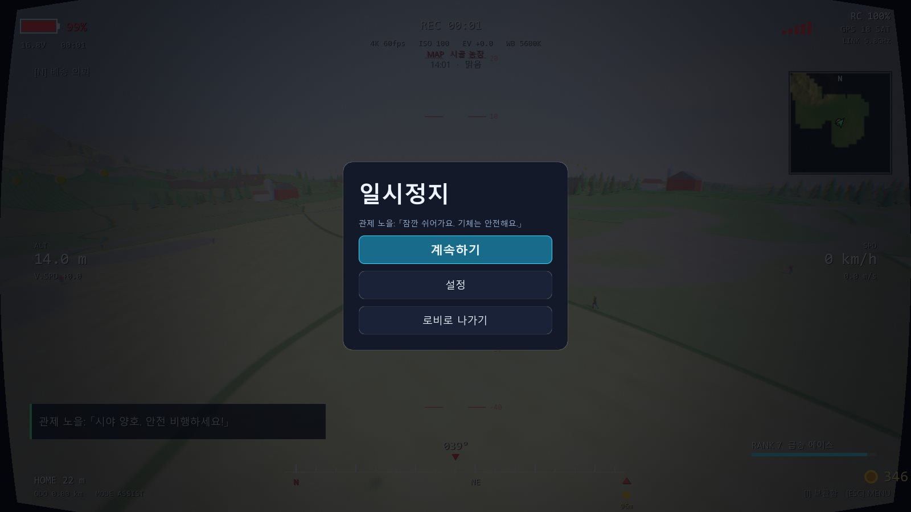

---

## 3. 조작

| 키 | 동작 | 키 | 동작 |
|---|---|---|---|
| W A S D | 이동 | 마우스 | 시점 (보는 방향으로 오르내림) |
| Space | 상승 | Ctrl / C | 하강 |
| Q / E | 좌·우 회전 | Shift | 부스트 |
| V | 1·3인칭 | F | 비행 보조 |
| 좌클릭 / J | 기관포 | G | 유도탄 (록온 후) |
| 우클릭 | 줌 | I | 보관함 |
| N | 배송 의뢰 | P | 사진 셔터 |
| M | 전체 지도 | R | 귀환 |
| O | 설정 | ESC | 일시정지 |

모든 키는 설정에서 재할당할 수 있고 게임패드(좌/우 스틱, A=사격 등)도 일부 지원합니다.

---

## 4. 기술 스택

| 분류 | 사용 기술 |
|---|---|
| 엔진 | **Godot 4.7.2** — Forward+ 렌더러, 3D, `MultiMesh`, `CPUParticles3D`, `SubViewport`, `Thread` |
| 언어 | **GDScript** (정적 타입 위주), Godot Shading Language(`*.gdshader`) |
| 그래픽 | 절차적 지형·건물 메시, 커스텀 하늘/물/지형/건물 셰이더, SSAO·글로우·안개·3D 스케일링 품질 단계, 후처리(색수차·속도선·빗방울·색약 보정) |
| 애니메이션 | Quaternius UAL 애니메이션 + 65본 스켈레톤, 슬롯 풀링(근거리 사람만 실제 스킨 메시) |
| 오디오 | 런타임 **가산 합성**(WAV 스트림 직접 생성), `AudioStreamGenerator`(모터음), Music/SFX 버스 |
| UI | 전부 코드로 구성한 `Control` + `StyleBoxFlat` 테마, 폰트 Rajdhani / Black Han Sans |
| 데이터 | JSON 저장(`user://save_N.json`), 기본값 위에 병합하는 마이그레이션 |
| 빌드 | `--export-pack` 으로 PCK 생성, GitHub Release로 배포 |
| 개발 도구 | 커맨드라인 개발 인자(자동 점검·스크린샷·시뮬레이션), `SceneTree` 스크립트로 모델 라인업 캡처 |

외부 에셋: Quaternius *Universal Base Characters / Animation Library* (CC0), 폰트 Rajdhani·Black Han Sans (SIL OFL), Godot (MIT).

---

## 5. 코드 구조

```
main.gd            중심 스크립트: 화면 흐름(타이틀→로비→로딩→월드), 월드 생성, 매 프레임 갱신, 입력, 보상 처리
├─ 월드
│  ├─ terrain.gd         무한 청크 지형(높이 함수 + 스트리밍) + terrain/water/farm/mars 셰이더
│  ├─ city.gd            160m 격자 도시, 도로·건물·가로등, MultiMesh
│  ├─ buildings.gd       폐건물/랜드마크, 건물 충돌(collide)과 공포 이벤트
│  ├─ props.gd           농장·화성 오브젝트
│  ├─ daynight.gd        태양·달·하늘 셰이더·안개·날씨·번개·비 파티클
│  └─ worlds.gd          맵 프로필(하늘/조명/안개/스폰)
├─ 생명체
│  ├─ traffic.gd         차선 추종·신호 위상·회전 곡선·충돌 회피·경찰차
│  ├─ people.gd, realpeople.gd   보행/대기/횡단/대화 상태 기계, 스킨 메시 풀
│  └─ birds.gd           새 무리
├─ 드론
│  ├─ drone.gd           비행 물리·배터리·신호·카메라 진동·체력
│  └─ dronemodel.gd      기체 4종 × 외장 10종 × 업그레이드 8종 절차적 모델
├─ 전투
│  ├─ combat.gd          전투 관리(발사·록온·탄환·유도탄·드랍·보급·웨이브·HUD 데이터)
│  ├─ enemy.gd           적 9종: 모델·스탯·AI·드랍 표
│  ├─ items.gd           전리품 목록
│  └─ inventory_panel.gd 보관함 UI / 판매
├─ 진행
│  ├─ profile.gd         저장 슬롯·랭크·해금·통계
│  ├─ missions.gd        미션 4종, 별점, 기록
│  ├─ goals.gd, secrets.gd, minimap.gd, tutorial.gd
│  └─ story.gd           세계관·문구·기체/외장 정의
└─ UI/사운드
   ├─ title / intro / lobby / pause / settings_panel / hud / ui.gd
   ├─ music.gd           7곡 합성(스레드)
   ├─ audio.gd           모터·바람·비·사이렌·전투 효과음
   └─ ui_audio.gd        메뉴 효과음 + 음악 플레이어
```

---

## 6. 주요 코드 살펴보기

### 6.1 음악을 파일 없이 합성 — `music.gd`
맵마다 코드 진행·BPM·악기 구성을 딕셔너리로 정의하고, 패드/베이스/플럭/벨/드럼 보이스를 합성해 8마디 루프(`AudioStreamWAV`)로 만듭니다. 곡 하나에 2~3초가 걸려서 **스레드**에서 만들고, 완성되면 크로스페이드로 교체합니다. 대기열 처리로 "만드는 중에 다른 곡을 요청해도 빠지지 않게" 했고, 한가할 때 나머지 곡을 미리 만듭니다.

```gdscript
"battle": {"bpm": 138, "root": 41, "minor": true, "chords": [0, 0, 3, -2], "pad": 0.4, "arp": 4, "bass": 2, "drums": 1, "bell": 0.0},

static func _voice_pad(L, R, n, t0, dur, f, amp, pan) -> void:
	for i in count:
		var t := float(i) / RATE
		var env := minf(t / 0.9, 1.0) * minf((dur - t) / 1.1, 1.0)   # 어택/릴리즈
		ph1 += f / RATE;  ph2 += f2 / RATE                           # 살짝 디튠된 두 개의 사인파
		var v := (sin(TAU * ph1) + sin(TAU * ph2) + 0.35 * sin(TAU * ph1 * 2.0)) * amp * env
```

### 6.2 록온과 유도탄 — `combat.gd`
십자선 약 17° 안의 가장 가까운 적을 0.85초 동안 유지하면 `locked`가 됩니다. 잠긴 뒤에는 약 31° 밖으로 0.6초 이상 벗어나야 풀립니다. 유도탄은 **회전 속도 제한**이 있어서(아군 3.4 rad/s, 적 1.25 rad/s) 플레이어가 급선회로 피할 수 있습니다.

```gdscript
var ang := dir.angle_to(want)
if ang > 0.0001:
	dir = dir.slerp(want, minf(1.0, turn * dt / ang)).normalized()   # 초당 turn(rad) 만큼만 조향
spd = minf(spd + accel * dt, vmax)
```

탄환은 노드가 아니라 딕셔너리 배열로 관리하고 `MultiMesh` 두 개(트레이서 박스, 구체)로 한 번에 그립니다. 이전 위치→현재 위치 **선분 대 구** 판정이라 빠른 탄도 뚫고 지나가지 않습니다.

### 6.3 하늘의 탄창/유도탄 — 30초 리젠 — `combat.gd`
월드를 260m 셀로 나누고 **셀 좌표 해시**로 보급품의 존재·종류·위치를 정합니다. 저장할 데이터가 없고 어디로 가도 일정하게 배치되며, 먹은 셀만 `pk_cd`에 30초 쿨다운을 넣습니다.

```gdscript
func _hash(ix: int, iz: int, salt: int) -> int:
	var h := ix * 73856093 ^ iz * 19349663 ^ salt * 83492791
	h = (h ^ (h >> 13)) * 1274126177
	return absi(h ^ (h >> 16))
```

### 6.4 적 9종 데이터 + AI — `enemy.gd`
스탯·드랍 표는 `TYPES` 딕셔너리 한 곳에 모으고, 종류별 `_ai_*` 함수가 행동을 정합니다. 난이도는 `tier`(1~5)와 체력/장갑/공격 패턴으로 구분합니다.

```gdscript
"golem": {"name": "바위 골렘", "tier": 3, "hp": 300.0, "armor": 0.5, "throw_cd": 4.6, "throw_dmg": 18.0,
	"drops": [["rock_shard", 0.9, 1, 3], ["golem_core", 0.35, 1, 1], ["repair", 0.3, 1, 1]]},
```
- 슬라임: 점프 이동 + 곡사 침 / 박쥐: 선회 → 급강하 물기 → 후퇴 / 골렘: 보행 + 바위 투척 + 지면 충격파
- 와이번: 원형 선회 + 화염탄 연사 / 공허의 눈: 구체 부채꼴 발사 + 경고선이 뜨는 레이저
- 적 드론: 플레이어 주위 공전 + 버스트 사격(선행 조준, 탄 퍼짐) + 유도탄(스트라이커/에이스)

피격 시 `fx.blood()`가 맞은 방향으로 핏방울을 튀깁니다(괴물별 피 색, 기계는 불꽃).

### 6.5 업그레이드가 모양을 바꾼다 — `dronemodel.gd`
`DroneModel.build(기체, 외장, 업그레이드 단계, LED색)`가 도형(박스·원통·구·토러스)을 조합해 모델을 만듭니다. 같은 함수를 인게임 3인칭 기체, 격납고 미리보기가 함께 씁니다.

```gdscript
if int(lv.get("speed", 0)) >= 2:       # 모터 링
	for m in c.motors: _torus(r, 0.014, 0.02, m, _m(c.led, 0.0, 0.4, 2.4))
var nb := int(lv.get("battery", 0)) / 2 # 배터리 팩이 위로 쌓임
```

### 6.6 마우스 에임 추종 비행 — `drone.gd`
앞으로 갈 때 카메라 피치(기준각 대비)에 따라 상승·하강 명령을 더해, 보는 곳으로 날아가게 합니다.

```gdscript
if sm.fwd > 0.05 and state == "flying":
	aim_thr = clampf(sin(deg_to_rad(cam_tilt - (22.0 if not third else -10.0))) * 1.6, -1.0, 1.0) * sm.fwd
	cmd.thr = clampf(cmd.thr + aim_thr, -1.0, 1.0)
```

### 6.7 그 밖의 설계 포인트
- **무한 지형**: 청크 단위로 높이 함수에서 생성·스트리밍하고, 도시는 격자 규칙으로 건물을 `MultiMesh` 배치 (`terrain.gd`, `city.gd`)
- **교통**: 공간 해시로 앞차·보행자 탐색, 신호 위상(주기 42초: 초록 17 / 노랑 2.5 / 빨강 1.5), 베지어 곡선 회전, 좌회전 시 대향차 양보 (`traffic.gd`)
- **사람 스킨 메시**: 60m 안의 사람만 풀(남 16 + 여 12)에서 실제 캐릭터로 교체, 의상은 `body.gdshader`가 휴지 자세 위치를 읽어 부위별로 색칠 (`realpeople.gd`)
- **안전한 저장**: 기본값 딕셔너리 위에 저장값을 재귀 병합해, 새 항목이 생겨도 옛 저장이 깨지지 않음 (`profile.gd`)
- **개발용 자동 점검**: `--selftest`(시간대·날씨·미션 순회 + 프레임 시간 프로파일), `--cshot`(전투 시나리오), `--trafficsim`(교통 400초 시뮬레이션) 등

---

## 7. 실행 / 빌드

```bash
# 에디터에서 실행: Godot 4.7.2 로 이 폴더를 열고 F5
# 개발 인자 예시 (-- 뒤에 붙임)
godot --path . -- --world=city --combat=duel
godot --path . -- --world=alpine --selftest=./out

# PCK 내보내기 (export_presets.cfg 의 "Windows Desktop" 프리셋)
godot --headless --path . --export-pack "Windows Desktop" SkyCourier.pck
```
릴리스(`SkyCourier.zip`)는 압축을 풀고 `SkyCourier.exe`를 실행하면 됩니다. (`SkyCourier.pck`와 같은 폴더)

## 8. 알려진 한계
- 음악과 효과음은 합성음이라 곡 완성도에 한계가 있습니다.
- 신호등 기둥은 충돌이 없고 보행자 신호등은 없습니다.
- 의상은 몸에 색을 입히는 방식이라 실제 옷 메시가 아닙니다.
- 괴물/적 드론 모델은 도형 조합의 저폴리 스타일입니다.
- 게임패드 지원은 일부 동작에 한정됩니다.

## 9. 라이선스·크레딧
- 캐릭터·애니메이션: Quaternius (CC0)
- 폰트: Rajdhani, Black Han Sans (SIL OFL)
- 엔진: Godot Engine (MIT)
- 그 외 코드·모델·사운드는 이 저장소에서 직접 작성했습니다.
